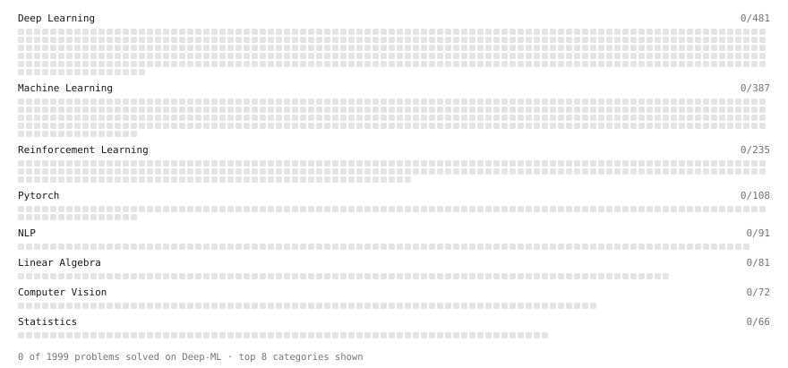

# Deep-ML

My machine learning practice from [Deep-ML](https://www.deep-ml.com). Every solution here was written by hand.

**8** solved · 0 problems · 0 labs · 8 math

[**Browse the interactive portfolio**](https://ioangatop.github.io/deep-ml-solutions/) to replay this filling in over time.

## Math

| | Difficulty | Solved | |
| --- | --- | --- | --- |
| [PagedAttention Internal Fragmentation](https://www.deep-ml.com/math-problems/67) | easy | 2026-11-12 | [solution](math/0067-pagedattention-internal-fragmentation) |
| [The KV Cache in Numbers: 800 KB per Token and How Many Requests Fit](https://www.deep-ml.com/math-problems/604) | easy | 2026-11-11 | [solution](math/0604-the-kv-cache-in-numbers-800-kb-per-token-and-how-many-requests-fit) |
| [Choosing the KV Block Size: Fragmentation, Sharing and Swap Transfers](https://www.deep-ml.com/math-problems/606) | medium | 2026-11-12 | [solution](math/0606-choosing-the-kv-block-size-fragmentation-sharing-and-swap-transfers) |
| [Information Theory: Entropy](https://www.deep-ml.com/math-problems/24) | medium | 2026-11-12 | [solution](math/0024-information-theory-entropy) |
| [Least Squares and the Normal Equations](https://www.deep-ml.com/math-problems/34) | medium | 2026-10-24 | [solution](math/0034-least-squares-and-the-normal-equations) |
| [Memory Saved by Sharing KV Blocks: Parallel Sampling and Beam Search](https://www.deep-ml.com/math-problems/605) | medium | 2026-11-12 | [solution](math/0605-memory-saved-by-sharing-kv-blocks-parallel-sampling-and-beam-search) |
| [Softmax and Cross-Entropy](https://www.deep-ml.com/math-problems/32) | medium | 2026-10-24 | [solution](math/0032-softmax-and-cross-entropy) |
| [KL Divergence](https://www.deep-ml.com/math-problems/25) | hard | 2026-11-12 | [solution](math/0025-kl-divergence) |

---

_This file is regenerated by Deep-ML on every push._
