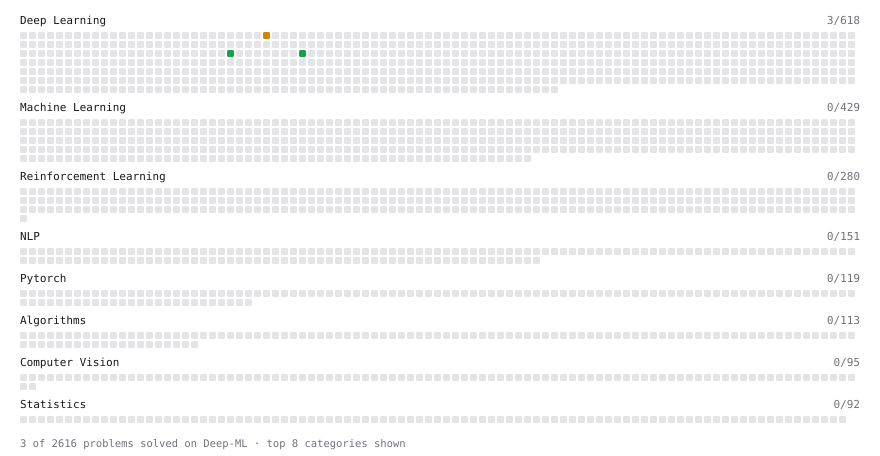

# Deep-ML

My machine learning practice from [Deep-ML](https://www.deep-ml.com). Every solution here was written by hand.

**19** solved · 10 problems · 0 labs · 9 math

[**Browse the interactive portfolio**](https://ioangatop.github.io/deep-ml-solutions/) to replay this filling in over time.

## Problems

| | Difficulty | Solved | |
| --- | --- | --- | --- |
| [Scale Attention Scores by sqrt(d_k)](https://www.deep-ml.com/problems/963) | easy | 2026-11-25 | [solution](problems/0963-scale-attention-scores-by-sqrt-d-k) |
| [Simple Self-Attention Without Trainable Weights](https://www.deep-ml.com/problems/955) | easy | 2026-11-25 | [solution](problems/0955-simple-self-attention-without-trainable-weights) |
| [Build Scaled Dot-Product Attention](https://www.deep-ml.com/problems/490) | medium | 2026-11-25 | [solution](problems/0490-build-scaled-dot-product-attention) |
| [Estimate KV Cache Size from Model Config](https://www.deep-ml.com/problems/418) | medium | 2026-11-25 | [solution](problems/0418-estimate-kv-cache-size-from-model-config) |
| [Implement Batched Causal Self-Attention](https://www.deep-ml.com/problems/957) | medium | 2026-11-25 | [solution](problems/0957-implement-batched-causal-self-attention) |
| [Implement Masked Self-Attention](https://www.deep-ml.com/problems/107) | medium | 2026-11-25 | [solution](problems/0107-implement-masked-self-attention) |
| [Implement Multiquery Attention (MQA)](https://www.deep-ml.com/problems/390) | medium | 2026-11-25 | [solution](problems/0390-implement-multiquery-attention-mqa) |
| [KV Cache for Efficient Autoregressive Attention](https://www.deep-ml.com/problems/376) | medium | 2026-11-25 | [solution](problems/0376-kv-cache-for-efficient-autoregressive-attention) |
| [Multi-Head Attention via Head Stacking](https://www.deep-ml.com/problems/958) | medium | 2026-11-25 | [solution](problems/0958-multi-head-attention-via-head-stacking) |
| [Implement Multi-Head Attention](https://www.deep-ml.com/problems/94) | hard | 2026-11-25 | [solution](problems/0094-implement-multi-head-attention) |

## Math

| | Difficulty | Solved | |
| --- | --- | --- | --- |
| [PagedAttention Internal Fragmentation](https://www.deep-ml.com/math-problems/67) | easy | 2026-11-12 | [solution](math/0067-pagedattention-internal-fragmentation) |
| [The KV Cache in Numbers: 800 KB per Token and How Many Requests Fit](https://www.deep-ml.com/math-problems/604) | easy | 2026-11-11 | [solution](math/0604-the-kv-cache-in-numbers-800-kb-per-token-and-how-many-requests-fit) |
| [Choosing the KV Block Size: Fragmentation, Sharing and Swap Transfers](https://www.deep-ml.com/math-problems/606) | medium | 2026-11-12 | [solution](math/0606-choosing-the-kv-block-size-fragmentation-sharing-and-swap-transfers) |
| [Information Theory: Entropy](https://www.deep-ml.com/math-problems/24) | medium | 2026-11-12 | [solution](math/0024-information-theory-entropy) |
| [Least Squares and the Normal Equations](https://www.deep-ml.com/math-problems/34) | medium | 2026-10-24 | [solution](math/0034-least-squares-and-the-normal-equations) |
| [Log-Likelihood Gradients](https://www.deep-ml.com/math-problems/38) | medium | 2026-11-12 | [solution](math/0038-log-likelihood-gradients) |
| [Memory Saved by Sharing KV Blocks: Parallel Sampling and Beam Search](https://www.deep-ml.com/math-problems/605) | medium | 2026-11-12 | [solution](math/0605-memory-saved-by-sharing-kv-blocks-parallel-sampling-and-beam-search) |
| [Softmax and Cross-Entropy](https://www.deep-ml.com/math-problems/32) | medium | 2026-10-24 | [solution](math/0032-softmax-and-cross-entropy) |
| [KL Divergence](https://www.deep-ml.com/math-problems/25) | hard | 2026-11-12 | [solution](math/0025-kl-divergence) |

---

_This file is regenerated by Deep-ML on every push._
